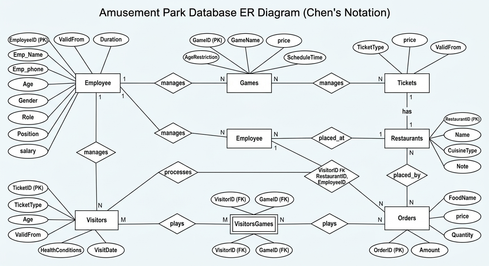

# Amusement Park Database Project (SQL)

A relational database for an amusement park, designed and implemented in MySQL. It covers employees, games, tickets, visitors, restaurants, and food orders, linked with primary and foreign keys.

> Group project for the Database course, Data Science Department, Umm Al-Qura University (2024).

## Requirements Summary
- Every entity has a unique ID (primary key).
- An employee can manage several games, tickets, and restaurants, and can take several food orders.
- A visitor must have a ticket, and can play several games (each visitor-game pair is unique).
- Visitors should only play games within the game's age restriction.
- Orders belong to one restaurant, one visitor, and one employee.

## Database Design
**Tables (7):** `employees`, `games`, `tickets`, `visitors`, `restaurants`, `orders`, `visitorsgame`

| Table | Primary key | Foreign keys |
|-------|-------------|--------------|
| employees | EmployeeID | none |
| games | GameID | Emp_ID → employees |
| tickets | TicketID | Emp_ID → employees |
| visitors | VisitorID | TicketID → tickets |
| restaurants | RestaurantID | Emp_ID → employees |
| orders | OrderID | Rest_ID → restaurants, Emp_ID → employees, Visit_ID → visitors |
| visitorsgame | (VisitorID, GameID) | VisitorID → visitors, GameID → games |

`visitorsgame` is the junction table for the many-to-many relationship between visitors and games.

## ER Diagram
The Entity-Relationship (ER) diagram illustrating the database structure and relationships:


## Files
- `amusement_park.sql`: full MySQL dump (table structure and sample data)
- `queries.sql`: example queries

## How to Run
1. Open MySQL Workbench (or any MySQL 8 client).
2. Create the database:
   ```sql
   CREATE DATABASE amusementpark;
   USE amusementpark;
   ```
3. Run `amusement_park.sql`.
4. Run the queries in `queries.sql`.

## Tools Used
MySQL 8.0, MySQL Workbench, SQL

## Team
- Aseel Nabeel Felemban
- Renad Abdullah Alzhrani
- Fay Salman Alzahrany
